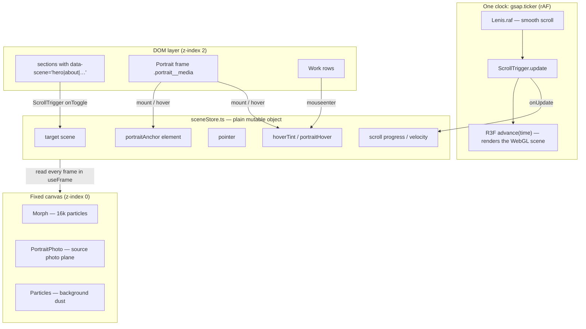

# Portfolio — Build Handoff

> How this site was designed and built, how every moving part works, why it is the way it is,
> and what's left. Written so anyone (including a future AI session) can pick it up cold.

**Owner:** Alireza Afshar — Senior Front-End Developer
**Last updated:** 2026-11-09
**Status:** Feature-complete first version, running locally. Not deployed, not under git yet.

---

## Contents

1. [What this is](#1-what-this-is)
2. [Run it](#2-run-it)
3. [Stack and why](#3-stack-and-why)
4. [Architecture](#4-architecture)
5. [File map](#5-file-map)
6. [The page, section by section](#6-the-page-section-by-section)
7. [WebGL deep dive](#7-webgl-deep-dive)
8. [Motion system](#8-motion-system)
9. [Design system](#9-design-system)
10. [How to change things](#10-how-to-change-things)
11. [Bugs we hit and how they were fixed](#11-bugs-we-hit-and-how-they-were-fixed)
12. [Decision log — how the design evolved](#12-decision-log--how-the-design-evolved)
13. [Open items and next steps](#13-open-items-and-next-steps)

---

## 1. What this is

A single-page portfolio built from Alireza's CV. Content: hero, about (with a particle portrait),
capabilities, selected work (8 shipped sites), experience, recognition, contact.

The signature idea: **one WebGL particle system (~16,000 points) lives behind the whole page and
re-forms into a different front-end symbol for every section** as you scroll — `</>` in the hero,
your portrait in About, a grid of UI components, a browser window, a git branch graph, an award
sparkle, an envelope. Particles fly between shapes through a noise field, react to the cursor and
to scroll speed, and take on each project's colours when you hover it in the Work list.

---

## 2. Run it

```bash
npm install
npm run dev        # http://localhost:5173
npm run build      # type-check + production build into dist/
npm run preview    # serve the production build
npm run lint       # oxlint
npm run cutout     # regenerate the portrait cutout from public/alireza.jpg (macOS only)
```

Node 22+. No environment variables, no backend.

---

## 3. Stack and why

| Tool | Version | Role | Why |
| --- | --- | --- | --- |
| React | 19 | UI | Alireza's main stack |
| Vite | 8 | Dev server / bundler | Fast, zero-config, code-splitting for the 3D chunk |
| TypeScript | 7 | Types | — |
| three.js | 0.187 | WebGL | Industry standard |
| @react-three/fiber | 9 | React renderer for three | Scene as components; `useFrame` per-frame logic |
| GSAP | 3.15 | All DOM animation | Timelines, ScrollTrigger, SplitText, quickTo, matchMedia |
| Lenis | 1.3 | Smooth scroll | Synced to GSAP's ticker so everything shares one clock |
| Plain CSS | — | Styling | One file of tokens + component styles; no build-time CSS tooling needed |

No drei, no postprocessing, no Tailwind — kept the dependency surface small and the shaders hand-written.

---

## 4. Architecture



Key principles:

- **The DOM never re-renders for animation.** Scroll, pointer and hover state go into a plain
  mutable object (`src/webgl/sceneStore.ts`) that the WebGL scene reads every frame. No React state,
  no context, no re-renders.
- **One clock.** Lenis, ScrollTrigger and the R3F render all run on `gsap.ticker`, in that order,
  so the scene always renders *after* scroll has updated in the same frame (this is what keeps the
  particle portrait pixel-locked to its DOM frame — see §7.5).
- **WebGL is optional.** The canvas is lazy-loaded in its own chunk and wrapped in an error
  boundary; if WebGL fails, the site still works as a normal page.
- **Content is data.** All copy lives in `src/data/content.ts`.

---

## 5. File map

```
portfolio/
├── HANDOFF.md                  ← this file
├── README.md                   short version + where things live
├── index.html                  meta tags, Google Fonts (Inter Tight, Instrument Serif)
├── public/
│   ├── alireza.jpg             portrait photo (999×1240, ~190 KB)
│   ├── alireza-cutout.png      person-only cutout (291×360) sampled into particles
│   ├── Alireza-Afshar-CV.pdf   "Download CV" target
│   └── favicon.svg
├── scripts/
│   └── cutout.swift            macOS Vision person segmentation → cutout PNG
└── src/
    ├── main.tsx                entry; forces scroll-to-top on reload
    ├── App.tsx                 layout: loader, fixed canvas, grain, nav, sections, footer
    ├── index.css               design tokens + all styles
    ├── data/content.ts         ALL copy (profile, hero facts, about, skills, jobs, projects, awards, nav)
    ├── lib/
    │   ├── motion.ts           Lenis setup, scrollToId, site-wide ScrollTrigger choreography
    │   ├── intro.ts            loader ↔ hero intro handshake
    │   └── pointer.ts          useMagnetic (magnetic + 3D tilt), useTilt (card tilt + glare)
    ├── components/
    │   ├── Loader.tsx          000→100 counter, curtain lift, starts the intro
    │   ├── Nav.tsx             glass pill nav, active-section pill, GSAP mobile menu
    │   ├── Hero.tsx            full-bleed fitted name, rotators, letter-lift, intro timeline
    │   ├── About.tsx           scrubbed statement, counters, facts, portrait frame
    │   ├── Portrait.tsx        DOM frame the particle portrait locks onto; hover/tap state
    │   ├── Skills.tsx · Work.tsx · Experience.tsx · Awards.tsx · Contact.tsx (+ Footer)
    │   ├── SectionHeader.tsx   index · rule · label · split-reveal title
    │   └── ui/
    │       ├── Button.tsx      magnetic pill: cursor-origin fill + rolling letters
    │       ├── RollText.tsx    per-letter roll on hover (pure CSS)
    │       └── Rotator.tsx     cycling words with masked slide
    └── webgl/
        ├── Scene.tsx           <Canvas>, ticker-driven render loop, pointer tracking
        ├── Morph.tsx           THE particle system: shapes, morphing, placement, frame-locking
        ├── shapes.ts           shape drawings → sampled points; portrait stipple sampler
        ├── PortraitPhoto.tsx   source photo plane + cyber scan-reveal shader
        ├── Particles.tsx       background dust with scroll parallax
        ├── sceneStore.ts       per-section scene states + the DOM↔WebGL bridge object
        ├── WebGLBoundary.tsx   error boundary
        └── shaders/
            ├── morph.ts        particle vertex/fragment shaders
            └── noise.ts        3D simplex noise (Ashima/Gustavson, MIT)
```

---

## 6. The page, section by section

### Loader (`Loader.tsx`, `lib/intro.ts`)
- Dark screen: name, "Portfolio ©2026", "Motion · 3D · Product UI", and a large counter `000 → 100`
  with a lime progress bar (~1.5 s).
- Curtain lifts with `clip-path: inset(0 0 100% 0)`. While it's still moving, `intro.start()` fires:
  the hero's paused timeline plays and `store.ready = true` lets the particles start building.
- Handshake: the hero *registers* a paused timeline on mount; the loader decides *when* it plays.
- Page scroll is locked during the loader (`html:has(.loader) { overflow: hidden }` + `lenis.stop()`).
- Reduced motion: no loader, intro starts immediately.

### Nav (`Nav.tsx`)
- Brand (magnetic "AA" mark + rolling name), glass pill of links, magnetic "Let's talk" CTA.
- **Active pill**: a highlight that slides to the hovered link, and rests on the section in view.
  Section → nav mapping: skills counts as About, awards as Experience.
- **Mobile menu**: one GSAP timeline, built once and paused. Opens with a circular `clip-path`
  expanding from the toggle's exact position, then links rise from masks with a stagger, then the
  footer links. Closing = the same timeline reversed at 1.7× speed. Escape closes; Lenis is stopped
  while open; `inert` + `aria-modal` for accessibility.

### Hero (`Hero.tsx`)
- **Full-bleed name**: "Alireza Afshar" spans the container edge to edge on one line (stacked on
  phones). The font size is *fitted in JS*: set 100px, measure the laid-out span
  (`lastLine.right − firstLine.left`), scale to the container width, cap by viewport height.
  Re-fits on resize (ResizeObserver) and when fonts load.
- **Single typeface** for the name (Inter Tight 600) — Alireza rejected the serif/sans mix.
- **Letter lift**: chars near the cursor rise (distance falloff, `gsap.quickTo` per char). Line
  masks have extra top padding so lifted letters aren't clipped.
- **Rotators**: specialties cycle after the role; shipped projects cycle in the bottom row.
- Everything fits in one viewport at every size (vertical spacing uses `svh`).
- **Intro timeline**: nav items drop in → eyebrow → name chars rise with rotation → tagline lines
  (SplitText masks) → buttons → bottom rule draws → meta items.
- Particles: `</>` sits top-right, above the name.
- No location anywhere on the site (explicit request).

### About (`About.tsx`, `Portrait.tsx`)
- Statement paragraph lights up word by word with scroll (`data-scrub-words`).
- Stats count up from zero (`data-count`), facts stagger in.
- **Particle portrait** in a sticky frame on the right (between statement and stats on phones).
  The particles leave `</>` and fly into the frame, forming a white-on-black stipple of Alireza.
- **Hover (tap on touch)**: particles stay; a lime scan line sweeps down and reveals the source
  photo *underneath* the particles in a cyber treatment. Label: "Source: alireza.jpg".

### Capabilities (`Skills.tsx`)
- 7 skill groups as rows of chips; rows batch-reveal, chips pop in with a stagger.
- Content column limited to ~64% width on desktop so the particle shape (components grid) has room.

### Selected work (`Work.tsx`)
- 8 projects as large rows: index, name, kind/note, URL.
- Hover: others dim, name shifts and switches to italic, an underline in the project's tint draws in,
  **and the particle cloud recolours to that project's tint** (`store.hoverTint`).

### Experience (`Experience.tsx`)
- 3 roles: period | role + company + bullets. Particles form a git branch graph.

### Recognition (`Awards.tsx`)
- 3 cards with 3D tilt toward the cursor and a gold glare that follows it (`useTilt`).

### Contact (`Contact.tsx`)
- "Let's build something that moves." big title, email link, magnetic buttons (copy email with
  live-region feedback, GitHub, CV). Particles form an envelope with a "new message" dot.
- Footer: ©, stack credit, rolling "Back to top".

---

## 7. WebGL deep dive

### 7.1 Scene setup (`Scene.tsx`)
- One `<Canvas>` fixed behind the page, `dpr [1, 1.75]`, camera at z=5, fov 40, alpha background.
- `frameloop="never"` + a `TickerDriver` that calls `advance(time)` from `gsap.ticker`.
  **`advance` takes seconds**, the same unit as R3F's clock (passing ms made every delta ~1000× too big).
- Lazy-loaded (`React.lazy`) so text paints before three.js downloads.
- Counts: 16,000 morph particles on desktop, 10,000 on narrow screens; 700 / 300 dust particles.

### 7.2 Shapes (`shapes.ts`)
Each glyph is **drawn on a 512×512 2D canvas** (text or paths), then its filled pixels are sampled:
- 35% of particles on outline pixels (crisp silhouettes), the rest on fill, 6% as a loose halo.
- z gets a small triangular-distributed depth so shapes read as 3D when they tilt.
- Shapes: `code` (`</>`), `braces` (`{ }`, unused now), `components`, `browser`, `branch`, `spark`,
  `mail`, `halo` (no drawing → every particle becomes loose dust; used as the portrait fallback),
  and `portrait` (async, see 7.4).

Adding a shape = one draw function + a key in `ShapeKey`.

### 7.3 Morphing (`Morph.tsx`, `shaders/morph.ts`)
- Geometry attributes: `aFrom`, `aTo` (positions), `aSeed` (random 0–1), `aColor` (portrait colours).
- When the target shape changes, the CPU **freezes the current eased positions into `aFrom`**, writes
  the new shape into `aTo`, and resets progress. Mid-transition retargets therefore never jump.
- Vertex shader:
  - Staggered progress per particle: `t = ease(clamp(progress*1.5 − seed*0.5))`
    (the CPU's `localProgress()` mirrors it exactly for the freeze step).
  - In-flight particles swirl through 3D simplex noise (`flight = sin(t·π)`), plus scroll-velocity turbulence.
  - Cursor push in local space (disabled on the framed portrait).
  - Colour: diagonal gradient between the section's `colorA/colorB`, blended to per-particle
    `aColor` by `uPhoto` for the portrait. Brighter while flying/pushed.
- Fragment: soft round sprite; additive blending; `#include <colorspace_fragment>` for correct sRGB output.
- Placement per section comes from `sceneStates` (x/y as fractions of half the viewport, z, scale,
  dim, colours), damped every frame; the group tilts toward the pointer and sways slowly.
- Phones: shapes behind text are faded (`dim ≥ 0.7`); the hero shape sits in the band above the text.

### 7.4 The particle portrait (`shapes.ts → loadPortraitShape`)
1. **Cutout**: `scripts/cutout.swift` runs Apple's on-device `VNGeneratePersonSegmentationRequest`
   (accurate) on the photo and writes a small transparent PNG (`npm run cutout`). No cloud service.
2. **Sampling = stippling**: build a density map over the whole frame and sample it with a CDF
   (binary search):
   - **Background** (transparent pixels) → a soft grey-white field, fading out near the frame edges.
   - **Person** → density ∝ `brightness^1.6` after percentile contrast-stretch, so the bright face
     "draws itself" while black hair and the black shirt get almost no particles and read as true black.
3. **Colour**: field particles grey (~0.72); person particles use the real photo colour lifted 55%
   toward white → warm natural whites. (A violet→orange ramp was tried and rejected — dark areas
   turned blue on the black page.)
4. **Flat**: z ≈ 0 (±0.01) — any depth would make perspective shift particles off the photo.

### 7.5 Locking the portrait to its DOM frame (the hard part)
The frame is a normal (sticky) DOM element; the particles are in a fixed canvas with perspective.
To keep them registered to the pixel:
- Every frame, read `portraitAnchor.getBoundingClientRect()`, convert its centre to world units at
  z=0 via `viewport.getCurrentViewport(camera, [0,0,0])`, and set the group's position; scale =
  frame height in world units ÷ `PORTRAIT_HEIGHT`. **No damping, no rotation** while framed.
- Because R3F renders on the GSAP ticker right after Lenis, the rect read is never a frame stale.
- **Entering the frame without a jump**: at the moment of retarget, the group snaps onto the frame
  *and* every particle's current position is re-expressed in the new space:
  `from_new = inverse(newMatrix) · oldMatrix · from_old`. Particles start exactly where they are on
  screen and fly straight in; there is no catch-up move afterwards, even if you scroll mid-morph.
- Verified numerically: projected group centre vs frame centre = 0 px offset at every sample,
  desktop and phone, including while scrolling during the transition.

### 7.6 Source photo reveal (`PortraitPhoto.tsx`)
- A plane with the photo texture inside the **same group** as the particles (so registration is
  automatic), rendered first; particles draw on top with additive blending.
- Hover drives `uReveal` 0→1 at constant speed (~1.1 s in, faster out). Shader:
  - Everything above a scan line moving top → bottom is revealed; the line glows lime.
  - Near the line: horizontal glitch slices and stronger RGB split.
  - Light cool tint (28%), subtle scanlines and flicker. Fully opaque.
- Particles soften by 30% while revealed so the photo reads through.

### 7.7 Background dust (`Particles.tsx`)
Points in a large box that wrap vertically with scroll at depth-dependent speeds (parallax), drift
sideways with time, and take the current highlight colour (`store.liveRim`).

---

## 8. Motion system (`lib/motion.ts` and friends)

**Smooth scroll**: Lenis on `gsap.ticker` (`lagSmoothing(0)`), `lenis.on('scroll', ScrollTrigger.update)`.
`scrollToId()` uses Lenis when present, native smooth scroll otherwise.

**Declarative scroll animations via data attributes** (one `gsap.context` in `useScrollChoreography`):

| Attribute | Effect |
| --- | --- |
| `data-scene="about"` | While the section crosses 55% of the viewport, set `store.target` (drives the particles) |
| `data-split` | Heading reveals line by line from masks (GSAP SplitText, `autoSplit` re-splits on resize/fonts) |
| `data-reveal` | Rises in once (`data-reveal-delay` optional) |
| `data-stagger` | Direct children rise in, batched as they enter; `.chip`s inside pop in |
| `data-count` + `data-suffix` | Number counts up from 0 |
| `data-scrub-words` | `.word` spans brighten word by word, scrubbed to scroll |
| `.section-header__rule` | Line draws from the left |

Plus a global ScrollTrigger feeding `store.progress` / `store.velocity` (NaN-guarded, decays each tick).

**Pointer effects** (`lib/pointer.ts`, fine pointers only, off for reduced motion):
- `useMagnetic(ref)` — element drifts toward the cursor, tilts in 3D, inner `[data-magnetic-inner]`
  layer moves further (parallax). Built on `gsap.quickTo`.
- `useTilt(ref)` — card tilt + `--gx/--gy` CSS vars for a glare gradient.

**Buttons** (`ui/Button.tsx`): fill circle grows from the exact entry point (`--x/--y` set on
pointerenter/leave) and shrinks toward the exit point; label letters roll via `RollText`
(each glyph carries a `text-shadow` copy one line below — no JS per frame).

**Rules that matter in React 19 StrictMode** (effects run twice in dev):
- Always wrap GSAP work in `gsap.context()` / `gsap.matchMedia()` and **`revert()`** in cleanup.
  Killing a `from()` tween without reverting leaves the element at the from-state, and the second
  run animates from 0 to 0.

**Reduced motion**: no Lenis, no loader, no reveals; rotators static; CSS transitions/animations off.

---

## 9. Design system

| Token | Value | Use |
| --- | --- | --- |
| `--bg` | `#08080a` | page (canvas mixes toward this) |
| `--fg` | `#ece9e2` | warm off-white text |
| `--muted` | `#8b8880` | secondary text |
| `--line` | `rgba(236,233,226,.12)` | hairlines, borders |
| `--accent` | `#c6f432` | lime: dots, crop marks, scan line, button fill |
| Fonts | Inter Tight (300–700), Instrument Serif italic | serif only for single emphasised words in section titles |
| Easing | `cubic-bezier(0.16, 1, 0.3, 1)` / GSAP `expo.out` | everywhere |
| Gutter | `clamp(20px, 4vw, 56px)` | container padding |
| Max width | 1440px | container |

Film grain overlay (animated SVG noise, 7% opacity). Glass surfaces: translucent bg + `backdrop-filter: blur`.
Section particle palettes are in `sceneStates` (hero violet→cyan, about orange, skills teal→lime,
work indigo, experience lime, awards gold, contact violet→lime).

---

## 10. How to change things

| I want to… | Do this |
| --- | --- |
| Edit any text, jobs, projects, awards | `src/data/content.ts` |
| Change which shape a section shows / its position / colours | `sceneStates` in `src/webgl/sceneStore.ts` |
| Add a new particle shape | add a draw function to `draws` in `shapes.ts`, add its key to `ShapeKey`, reference it in `sceneStates` |
| Add a section with its own shape | add a key to `SceneKey` + `sceneStates`, put `data-scene="key"` on the `<section>` |
| Change the portrait photo | replace `public/alireza.jpg`, run `npm run cutout`, keep the frame `aspect-ratio` in `index.css` matching the photo |
| Tune the portrait look | `FIELD_WEIGHT` (background density), `FIELD_GREY` (background brightness), the `1.6` exponent (face contrast) in `shapes.ts` |
| Tune the hover reveal | `PortraitPhoto.tsx` fragment shader (tint mix, scanlines, beam) and sweep speeds in `useFrame` |
| Change a project's hover colour | its `tint` in `content.ts` |
| Animate a new element on scroll | add `data-reveal`, `data-split`, `data-stagger` or `data-count` — no JS needed |
| Make a new button | `<Button variant="solid" href="…">Label</Button>` |

---

## 11. Bugs we hit and how they were fixed

Worth knowing — most are general R3F/GSAP gotchas.

| Symptom | Cause | Fix |
| --- | --- | --- |
| WebGL blob invisible | Uniform updates went to a different object than the material used (StrictMode/useMemo identity) | Always read uniforms from the material ref: `material.current.uniforms` |
| Blob distortion NaN | `ScrollTrigger.getVelocity()` can be NaN on first update | `Number.isFinite` guards, `|| 0` on use |
| Reload landed mid-page | ScrollTrigger restores scroll positions itself, overriding `history.scrollRestoration` | `ScrollTrigger.clearScrollMemory('manual')` + `scrollTo(0,0)` on boot |
| Whole page went black | `useEffect(onReady)` returned a `requestAnimationFrame` id → React treated it as cleanup and crashed the tree | Wrap: `useEffect(() => { onReady() }, …)`; WebGL parts behind error boundaries |
| Card stuck invisible | `gsap.from` killed (not reverted) in StrictMode cleanup | `gsap.context()` / `matchMedia()` + `revert()` |
| Scroll trigger never fired | Trigger element was `position: sticky` (ScrollTrigger mis-measures it) | Trigger off the non-sticky parent |
| Portrait colours turned blue/invisible | Additive blending: black particles add nothing on a black page | White-on-black stipple; darks get *fewer* particles instead of dark colours |
| Portrait drifted off its frame | Pointer tilt/sway, z-relief under perspective, and R3F/Lenis on separate rAFs | No rotation or depth when framed; render on gsap.ticker after Lenis |
| Animations ran far too fast | `advance(performance.now())` — R3F expects **seconds** | `advance(gsapTickerTime)` |
| Correction move after morph into frame | Group eased to the frame then snapped | Lock group at retarget + re-base particle positions with matrices |
| `@` read as a blob | Thin monospace glyph in particles | Replaced with a drawn envelope icon |

---

## 12. Decision log — how the design evolved

Alireza's working style: wants strong proposals he can **confirm or reject**, minimal back-and-forth,
perfectionist about details. The site was iterated in this order:

1. **v1** — Vite + R3F scaffold, all CV content, an iridescent noise-displaced **blob** with per-section shader states.
2. "Why a circular object for a front-end dev?" → replaced by the **particle morph through front-end symbols**.
3. Hero must **fit one viewport** at every size → svh-based sizing.
4. Added loader + staggered intro, magnetic/rolling buttons, nav pill, GSAP mobile menu, scroll reveals,
   counters. **Removed location everywhere.** Name moved to a **single typeface**.
5. Hero redesign options offered → chose **full-bleed name** (edge-to-edge, JS-fitted).
6. Photo added → first as a **shader card** (halftone build-on-scroll + inspect lens). Rejected later.
7. "Can particles become my shape?" → Vision cutout + coloured particle portrait, first cycling in the hero
   with `</>`. **Rejected the flow**: `</>` shouldn't become the portrait.
8. Final flow: **hero = `</>` only; About = particle portrait in a frame**, replacing the card.
   Colours changed to **white-on-black stipple**. Hover first scattered particles + revealed photo — rejected
   ("don't remove the particles"), replaced with the **cyber scan-reveal of the source photo under the particles**.
9. Registration fixes (pixel-locked frame, no post-morph move), photo fully opaque.
10. Contact `@` → **envelope** icon.

---

## 13. Open items and next steps

**Before launch**
- [ ] `git init` + first commit (the project is not under version control yet).
- [ ] Deploy (Vercel/Netlify static: build command `npm run build`, output `dist`).
- [ ] Open Graph image (`og:image`) — meta tags exist, no image yet.
- [ ] Real-device testing on mid-range phones (GPU load of 10k particles + reveal shader).
- [ ] Lighthouse pass (performance + accessibility).

**Polish ideas**
- [ ] Bundle: the 3D chunk is ~250 KB gzipped (whole three.js + R3F). Could trim with manual three imports.
- [ ] Glyphs drawn with system monospace (`Menlo`/`Consolas`) — draw with a loaded webfont for consistency across OSes.
- [ ] Section titles still use one serif-italic word each — confirm keep vs. all Inter Tight.
- [ ] LinkedIn / other socials not in the CV, so not on the site — add if wanted.
- [ ] `braces` shape is unused (kept for reuse).

**Dev-only debug hooks** (stripped from production builds):
- `window.__r3f` — R3F state (set in `Scene.tsx` `onCreated`)
- `window.__store` — the scene store (bottom of `sceneStore.ts`)

**Known lint warnings** (intentional): oxlint flags `Math.random` in `useMemo` and mutating the
geometry inside `useFrame` — both are the normal three.js pattern here.

---

## Performance pass (2026-11-10)

Lighthouse (production build, `vite preview`): **mobile 56 → 94–95, desktop 85 → 100**, no visual change.

| Metric (mobile) | Before | After |
| --- | --- | --- |
| FCP | 3.9 s | 1.5 s |
| LCP | 4.5 s | 1.8 s |
| TBT | 560 ms | ~240 ms |
| Speed Index | 7.0 s | 1.5 s |

What changed and why:

- **Loader is static HTML** (`index.html` `#boot-loader`). `Loader.tsx` renders nothing; it adopts that element
  and animates it. Before, nothing painted until the JS bundle ran. Adopting (not re-rendering) keeps the
  counter the same DOM node, so LCP is the early paint, not React's later copy.
- **Fonts are self-hosted** (`public/fonts`, `@font-face` inline in `index.html`, Inter Tight preloaded). Same
  families/weights as the old Google Fonts link, minus ~1.3 s of render-blocking third-party CSS. OFL licences included.
- **Particle shapes are sampled in a Web Worker** (`webgl/shapes.worker.ts`, driven by `webgl/shapeStream.ts`)
  with OffscreenCanvas: `</>` first, then the other shapes, then the portrait. Browsers without OffscreenCanvas
  fall back to sampling one shape per idle slice. `ensureShape` samples on the spot if one is ever needed early.
- **Shaders compile in parallel** (`gl.compileAsync` in `Scene.tsx` `TickerDriver`) before the first frame,
  while the particles are still hidden under the loader.
- **Source photo texture** (`PortraitPhoto`) mounts when the page is idle, not at start-up.
- **Below-the-fold scroll animations** (`useScrollChoreography`) are set up in ~10 ms idle slices
  (`lib/idle.ts` `runInIdleSlices`) instead of one long task at mount. They all sit under the loader / below the fold.
- `html:has(.loader)` → `html.is-loading` class (a `:has()` on `<html>` re-checks on every DOM change).

Not done (no score impact or would change visuals): converting `alireza.jpg` / `alireza-cutout.png` to WebP
(Lighthouse "modern image formats" hint; both now load off the critical path), trimming three.js (R3F imports the
whole namespace).
